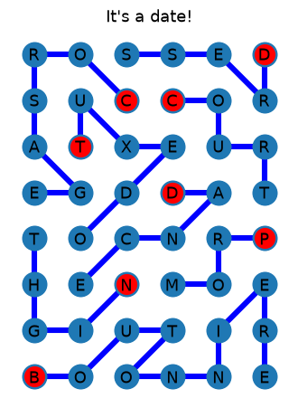

# NYTimes Strands Solver

Solves the daily [Strands](https://www.nytimes.com/games/strands) puzzle from The New York
Times. It finds every dictionary word hidden in the letter grid and embeds each word into a
vectorspace over the board's cells. It then solves for the sets of words whose vectors add up to
the whole board, and ranks those solutions by how common their words are.



## Usage

You need [uv](https://docs.astral.sh/uv/). Then run:

```sh
uv run main.py
```

uv installs Python and the dependencies on the first run. The solver downloads today's
puzzle, prints every candidate solution with a confidence score, and opens a window
showing the best one. Starting letters are drawn in red.

For the "It's a date!" puzzle in the test data, the list of solutions begins like this:

```text
Found the following solution(s):
CORSAGE, DRESS, TUXEDO, COURT, DANCE, NIGHT, PROM, BOUTONNIERE with confidence 0.51/1.00
CORSAGE, DROSS, TRUCE, TUXEDO, DANCE, NIGHT, PROM, BOUTONNIERE with confidence 0.44/1.00
CORSAGE, DRESS, TUXEDO, COUD, TRANCE, NIGHT, PROM, BOUTONNIERE with confidence 0.43/1.00
```

The first run will take about a second longer as it builds the dictionary and trie caches it to `strandssolver/test/data/words_trie_cache_*.json`. If you edit
`words_trie.json`, delete the cache file so it gets rebuilt.

## How it works

Solving Strands means choosing words that use every letter on the board exactly once. The
solver turns that into linear algebra: each word becomes a vector, and a solution is a choice
of vectors that adds up to the all-ones vector. The numbers below are for the "It's a date!"
puzzle.

### 1. Read the puzzle

`main.py` first asks NYT's puzzle endpoint (`https://www.nytimes.com/svc/strands/v2/<date>.json`)
for today's letters, theme and number of theme words. That response also contains the
answers, but the solver doesn't use them. If the endpoint isn't available, the solver opens
the game page in headless Chrome with Selenium and reads the letters from the page.

### 2. Find every word on the board

Each of the 48 letters (8 rows by 6 columns) is a node connected to its up to eight
neighbours, including diagonals. A word on the board is a path through these nodes that
never visits a letter twice.

A depth-first search starts from every letter and extends the path one neighbour at a time.
The dictionary is stored as a [trie](https://en.wikipedia.org/wiki/Trie), which allows for early pruning. The
dictionary combines two word lists:

- **[dwyl/english-words](https://github.com/dwyl/english-words):** about 367,000 words of at
  least four letters, the minimum length in Strands.
- **[wordfreq](https://github.com/rspeer/wordfreq):** common English words that dwyl lacks,
  such as `improv`, `podcast` and `selfie`. Only words with a Zipf frequency of 3.0 or more
  are added, which means they appear at least about once per million words of text.

For the example puzzle, the search finds 1,532 word paths, made up of 1,071 different words, in about 0.2 seconds.

### 3. Embed each word as a vector

Number the board's 48 cells, each becomes a dimension in the embedding space. Then each word is embedded as a 48-dimensional vector with one value per cell: 1 if the
word uses that cell, 0 if it doesn't. Placing these for example 1,532 vectors side by side as columns gives a
matrix ${𝐀,}$ which encapsulates the entire puzzle as a linear algebra problem.

A candidate solution is then a vector ${\vec{x}}$ with one entry per word: 1 if the word is chosen, 0
if not. The product $`{𝐀\vec{x}}`$ thus counts, for every letter, how many of the chosen words use it.
Strands needs every letter used exactly once, so the target is the all-ones vector $`{\vec{b},}`$ and
a solution is any binary $`{\vec{x}}`$ with

```math
𝐀\vec{x} = \vec{b}
```

The residual $`{\vec{r} = 𝐀\vec{x} - \vec{b}}`$ shows what's wrong with a candidate. It's 0 where a cell is used
once, −1 where a cell is left over, and +1 or more where chosen words overlap.

For example, take three cells and three words, where word 1 uses cells 1 and 3, word 2 uses
cell 3, and word 3 uses cells 1 and 2:

```math
𝐀 = \begin{pmatrix} 1 & 0 & 1 \\ 0 & 0 & 1 \\ 1 & 1 & 0 \end{pmatrix}, \qquad
\vec{b} = \begin{pmatrix} 1 \\ 1 \\ 1 \end{pmatrix}
```

Choosing words 2 and 3, $`{\vec{x} = (0, 1, 1),}`$ gives $`{𝐀\vec{x} - \vec{b} = (0, 0, 0),}`$ a perfect cover.
Choosing words 1 and 3, $`{\vec{x} = (1, 0, 1),}`$ gives $`{𝐀\vec{x} - \vec{b} = (1, 0, 0):}`$ cell 1 is used
twice. This is the example in `optimizecovering._test()`.

### 4. Solve for the smallest residual

`BinaryOptimizer` in `solver/optimizecovering.py` looks for the binary $`{\vec{x}}`$ with the
smallest residual:

```math
\min_{\vec{x} \in \{0,1\}^m} \lVert 𝐀\vec{x} - \vec{b} \rVert_1
\quad \text{subject to} \quad \sum_j x_j \le k
```

Here $`{m}`$ is the number of words. $`{k}`$ is the puzzle's number of theme words plus one,
because the spangram sometimes consists of two dictionary words, like FUNNY + BUSINESS
for FUNNYBUSINESS.

To make the problem linear, each absolute value gets a helper variable $`{t_i}`$ with
$`{t_i \ge (𝐀\vec{x} - \vec{b})_i}`$ and $`{t_i \ge -(𝐀\vec{x} - \vec{b})_i,}`$ and the optimizer minimizes
$`{\sum_i t_i.}`$ That's a binary integer linear program, which the optimizer builds with
[PuLP](https://coin-or.github.io/pulp/) and solves with CBC. A minimum of zero means a perfect
cover. For the example, CBC finds one among the 1,532 binary variables in about 1.3 seconds.

### 5. Find every exact solution and rank them

A residual of zero doesn't identify the answer on its own. The example has 31 different
binary $`{\vec{x}}`$ with $`{𝐀\vec{x} = \vec{b},}`$ and CBC returns whichever one it reaches first. Here that's
DROUD, SUCCESSOR, EXTA, GEOD, TRANCE, PROM, NIGHT, BOUTONNIERE which is not the puzzle's solution.

So `Solver.solve()`, which `main.py` uses, lists every binary $`{\vec{x}}`$ with $`{𝐀\vec{x} = \vec{b}}`$ and at
most $`{k}`$ words, then ranks them. To keep that search fast, it:

- stores each column of $`{𝐀}`$ as a bitmask, so checking whether two words overlap is a
  single bitwise AND;
- always fills the first empty cell, row by row, and only tries words that cover it;
- stops early when the remaining words couldn't be long enough to fill the rest of the
  board;
- remembers partly filled boards that turned out to be dead ends, so it never searches them
  twice.

This finds all 31 solutions in about 0.3 seconds. Each solution's score is the average
[Zipf frequency](https://github.com/rspeer/wordfreq#usage) of its words: theme words are
words people actually use, while the other solutions need obscure dictionary entries. The
answer scores 3.93. The lowest-ranked solution (CORSAGE, TUSSOR, TRADUCED, CODEX, THIONINE,
PERNOR, EGBO, MUNT) scores 1.10.

The printed confidence is the score divided by the highest possible score, the frequency of
the most common English word, "the" (7.73). The answer above scores 3.93 / 7.73 ≈ 0.51.

## Limitations

- **Missing words.** A word that's in neither dictionary can't be found, so the solver
  returns a wrong solution or none at all.
- **Website fallback.** Reading the puzzle from the game page depends on NYT's page layout.
  It may break when that changes.

## Project layout

| Path | Contents |
| --- | --- |
| `main.py` | Entry point of the program |
| `strandssolver/readers/` | Fetch the puzzle from the NYT |
| `strandssolver/parsers/` | Parse the puzzle data into a `GameState` |
| `strandssolver/models/` | Modelling the different problem parts as classes |
| `strandssolver/dfs/` | Extension of `networkx` depth-first search that reports its progress to a visitor |
| `strandssolver/solver/` | Where the magic happens |
| `strandssolver/test/` | Benchmarks and test data  |

## Development

```sh
uv sync                                         # set up .venv
uv run python -m strandssolver.solver.solver    # solve the saved test puzzle
# Before every commit
uvx ruff format .                               # format
uvx ruff check .                                # lint
uvx ty check                                    # type-check
```

Most modules have a `_test()` function you can run with `uv run python -m <module>`.

## Credits

- `words_dictionary.json` is
  [`words_dictionary.json`](https://github.com/dwyl/english-words/blob/a77cb15f4f5beb59c15b945f2415328a6b33c3b0/words_dictionary.json)
  from [dwyl/english-words](https://github.com/dwyl/english-words/tree/master), licensed
  under [The Unlicense](https://github.com/dwyl/english-words/blob/a77cb15f4f5beb59c15b945f2415328a6b33c3b0/LICENSE.md).
- Word frequencies come from [wordfreq](https://github.com/rspeer/wordfreq) by Robyn Speer.
  The code is licensed under Apache-2.0 and the data under
  [CC BY-SA 4.0](https://creativecommons.org/licenses/by-sa/4.0/).
- The residual optimizer uses [PuLP](https://coin-or.github.io/pulp/) with the
  [CBC](https://github.com/coin-or/Cbc) solver.
- This project isn't affiliated with The New York Times. Strands is a New York Times game.
